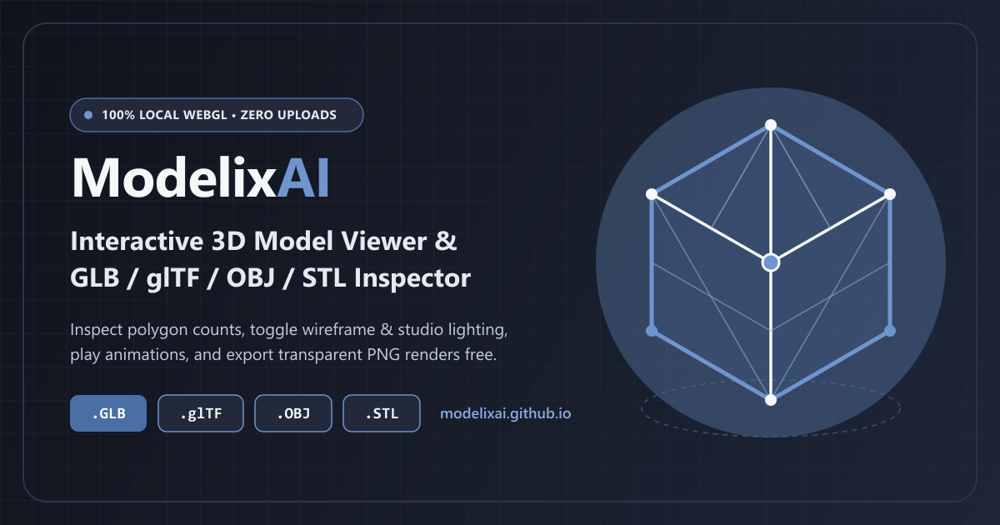

<div align="center">

<a href="https://modelixai.github.io/">
  
</a>

<br />
<br />

# ModelixAI

**Interactive 3D Model Viewer & GLB / glTF / OBJ / STL Mesh Inspector — 100% Private in Your Browser**

[](https://modelixai.github.io/)
[](https://astro.build/)
[](https://react.dev/)
[](https://threejs.org/)
[](https://modelixai.github.io/)
[](./LICENSE)

<p align="center">
  <a href="https://modelixai.github.io/"><strong>Launch 3D Viewer</strong></a> ·
  <a href="https://modelixai.github.io/how-to-use/"><strong>How to Use Guide</strong></a> ·
  <a href="https://github.com/modelixai/modelixai.github.io/issues"><strong>Report a Bug</strong></a> ·
  <a href="https://modelixai.github.io/hire-me/"><strong>Hire the Developer</strong></a> ·
  <a href="https://kisharadilshan.gumroad.com/coffee"><strong>Buy Me a Coffee</strong></a>
</p>

</div>

---

## Overview

**ModelixAI** ([modelixai.github.io](https://modelixai.github.io/)) is an ultra-fast, studio-precision 3D model viewer and mesh inspector built for **3D artists**, **game developers**, **web engineers**, and **CAD / 3D printing makers**.

Unlike cloud-based viewers that upload your files to remote servers, ModelixAI executes **100% client-side in your browser using WebGL and Three.js**. Confidential CAD prototypes, client product renders, and unreleased game assets never leave your device's local memory—and once installed as a Progressive Web App (PWA), the entire studio works **completely offline**.

---

## Supported 3D Formats

Drop a single 3D file or drag an entire multi-file asset folder directly onto the viewport. Companion binary buffers, material libraries, and texture maps are linked automatically in memory via custom `Blob` URL mapping.

| Format | Extensions | Capabilities & Multi-File Support |
| :--- | :--- | :--- |
| **GLB (Binary glTF 2.0)** | `.glb` | Embedded PBR metallic-roughness materials, textures, skeletal/morph/keyframe animations, and local Draco mesh decompression. |
| **glTF 2.0** | `.gltf` + `.bin` + textures | Multi-file drop support automatically resolving external `.bin` geometry buffers, Draco-compressed meshes, and `.png` / `.jpg` / `.webp` textures. |
| **Wavefront OBJ** | `.obj` + `.mtl` + textures | Multi-file drop support pairing `.obj` geometry with `.mtl` material definitions and diffuse/specular texture maps (or studio clay fallback when untextured). |
| **Stereolithography (CAD)** | `.stl` (Binary & ASCII) | Precision triangle inspection for 3D printing and mechanical CAD, including one-click **Z-Up Upright** orientation alignment to stand Z-up slicer exports flat on the build grid. |

> **Built-in Showcase Samples:** Don't have a 3D model handy? Click **Load Sample Model** (procedural multi-mesh animated PBR gyroscope) or **Sample CAD STL** (binary STL precision spur gear) directly in the toolbar to test every feature immediately.

---

## Studio Features

### 1. Live Mesh & Dimension Inspector
Instantly audit model health before importing into Unity, Unreal Engine, Blender, WebGL apps, or 3D print slicers:
- **Format Detection** (`GLB`, `glTF 2.0`, `OBJ`, `OBJ + MTL`, `STL`)
- **Exact Triangle (Polygon) Count** & **Total Vertex Count**
- **Mesh Draw-Call Group Count**
- **Unique Materials & Active Texture Maps**
- **True Unscaled Bounding Dimensions (`X × Y × Z`)** measured prior to viewport camera normalization
- **Total Payload File Size**

### 2. Viewport & CAD Orientation Controls
- **Wireframe Overlay:** Inspect polygon density, edge loops, and decimation topology in real time.
- **Reference Grid Floor:** Studio ground plane automatically aligned to the base of your model.
- **Z-Up Upright Flip:** Converts Z-up CAD/slicer coordinate systems (Fusion 360, SolidWorks, OpenSCAD, PrusaSlicer) to Y-up upright orientation in one click.
- **Auto-Rotate Turntable:** Smooth 60fps orbital presentation mode.
- **Reset Camera:** Automatically re-centers and frames any model using bounding-sphere math.

### 3. Calibrated Studio Lighting & Backdrops
- **4 Studio Lighting Presets** powered by `PMREMGenerator` + `RoomEnvironment`:
  - `Studio Neutral` — Balanced neutral white key, cool fill, and soft rim light for accurate PBR material checks.
  - `Soft Rim` — High-contrast edge rim lighting to highlight silhouettes and surface bevels.
  - `Warm Clay` — Architectural warm sunlight paired with cool ambient shadow fill.
  - `Cool Blueprint` — Technical steel-blue CAD inspection lighting.
- **3 Viewport Backdrops:** Switch between **Clean Light**, **Studio Dark**, and **Transparent Checkerboard** stages, plus full site-wide **Light / Dark Theme** persistence with WCAG AA+ contrast (≥ 4.5:1).

### 4. glTF Animation Playback & Scrubbing
- Automatically detects embedded `AnimationClip` tracks inside `.glb` and `.gltf` models.
- Switch between named clips, toggle **Play / Pause**, and scrub frame-by-frame with the interactive timeline slider.

### 5. One-Click Alpha-Transparent PNG Export
- Click **Export Transparent PNG** from any camera angle and lighting preset.
- Temporarily clears the scene background and floor grid for a single WebGL render pass (`preserveDrawingBuffer: true`, `alpha: true`), downloading a crisp, background-free alpha PNG ready for documentation, pitch decks, or storefronts.

### 6. Offline PWA ("Add to Home Screen")
- Installable across desktop (Chrome, Edge), Android, and iOS Safari.
- Cache-first Service Worker (`public/sw.js`) caches the application shell, Three.js engine, and local Draco WebAssembly decoders (`public/draco/`) for 100% offline 3D inspection.

---

## Viewport Navigation Quick Reference

| Action | Desktop (Mouse / Trackpad) | Mobile & Tablet (Touch) |
| :--- | :--- | :--- |
| **Orbit Camera** | Left-click + drag | One-finger drag |
| **Zoom In / Out** | Scroll wheel or trackpad pinch | Two-finger pinch |
| **Pan Target** | Right-click + drag (or `Shift` + drag) | Two-finger drag |
| **Fit & Re-center** | Click **Reset Camera** | Tap **Reset Camera** |
| **Open File Picker** | Click dropzone or press `Enter` / `Space` | Tap **Open 3D Model** |

---

## Architecture & Tech Stack

ModelixAI uses **Astro 5 Islands Architecture** so static documentation, navigation, and localized content ship as **zero-JavaScript static HTML**, hydrating React and Three.js strictly for the interactive 3D viewport.

- **Framework:** [Astro 5](https://astro.build/) (`output: 'static'`, directory trailing-slash routing)
- **Interactive UI Island:** [React 19](https://react.dev/) + TypeScript (`ModelViewerIsland.tsx` via `client:load`)
- **3D Rendering Engine:** [Three.js](https://threejs.org/) (`GLTFLoader`, `DRACOLoader`, `OBJLoader`, `MTLLoader`, `STLLoader`, `OrbitControls`, `RoomEnvironment`)
- **Styling & Design System:** [Tailwind CSS](https://tailwindcss.com/) + CSS Custom Properties (`#F7F8FA` Studio Alabaster, `#E6EAF0` Cool Mist, `#4A6FA5` Blueprint Steel, `#1E2538` Obsidian Slate)
- **Privacy & Memory Safety:**
  - Zero third-party analytics or tracking scripts (`0` external requests).
  - Self-hosted Draco WASM decoders in `public/draco/` (`0` external CDN dependencies).
  - Deterministic GPU cleanup (`geometry.dispose()`, `material.dispose()`, `texture.dispose()`, and `URL.revokeObjectURL()`) on every model swap and component unmount.

### Project Structure

```text
modelixai.github.io/
├── .github/
│   ├── FUNDING.yml                  # Developer sponsorship configuration
│   └── workflows/
│       └── deploy.yml               # Automated GitHub Pages CI/CD pipeline
├── public/
│   ├── draco/                       # Local Draco WASM & JS mesh decoders
│   ├── icons/                       # 192x192, 512x512 & SVG PWA app icons
│   ├── favicon.svg                  # Isometric 3D cube-mesh vector icon
│   ├── manifest.webmanifest         # Standalone offline PWA manifest
│   ├── og-image.png                 # Static 1200x630 Open Graph preview card
│   ├── robots.txt                   # Search crawler directives + sitemap link
│   └── sw.js                        # Cache-first offline Service Worker
├── src/
│   ├── components/
│   │   ├── pages/                   # Shared localized Home, HowToUse & HireMe views
│   │   ├── Breadcrumbs.astro        # Semantic subpage breadcrumb navigation
│   │   ├── Footer.astro             # Landmark footer & privacy summary
│   │   ├── ModelViewerIsland.tsx    # Client-side Three.js 3D Viewer & Inspector
│   │   └── Navbar.astro             # Desktop bar + >=48px icon-only mobile nav
│   ├── i18n/
│   │   └── translations.ts          # Complete human translations (8 languages)
│   ├── layouts/
│   │   └── BaseLayout.astro         # SEO head, hreflang, JSON-LD & anti-FOUC theme
│   ├── pages/
│   │   ├── [lang]/                  # Localized static routes (es, pt, de, fr, ja, zh, ru)
│   │   ├── hire-me/index.astro      # English Hire Me route (/hire-me/)
│   │   ├── how-to-use/index.astro   # English How to Use route (/how-to-use/)
│   │   ├── index.astro              # English Home route (/)
│   │   └── sitemap.xml.ts           # Flat Google Search Console <urlset> endpoint
│   └── styles/
│       └── global.css               # Light/Dark CSS tokens & studio utilities
├── astro.config.mjs                 # Astro 5 static configuration & chunk splitting
├── package.json                     # Scripts & dependencies
├── tailwind.config.mjs              # Tailwind theme mapping to CSS variables
└── tsconfig.json                    # Strict TypeScript configuration
```

---

## Internationalization (8 Languages) & Technical SEO

Every page is statically generated across **8 languages** with reciprocal `<link rel="alternate" hreflang="...">` tags, `hreflang="x-default"`, self-referencing canonical URLs, a flat `/sitemap.xml` (`<urlset>`), and structured JSON-LD (`WebApplication`, `FAQPage`, `HowTo`, `Person`, and subpage `BreadcrumbList`).

| Language | Locale Code | URL Prefix | Live Link |
| :--- | :---: | :---: | :--- |
| **English** *(Default)* | `en` | `/` | [modelixai.github.io/](https://modelixai.github.io/) |
| **Español** | `es` | `/es/` | [modelixai.github.io/es/](https://modelixai.github.io/es/) |
| **Português** | `pt` | `/pt/` | [modelixai.github.io/pt/](https://modelixai.github.io/pt/) |
| **Deutsch** | `de` | `/de/` | [modelixai.github.io/de/](https://modelixai.github.io/de/) |
| **Français** | `fr` | `/fr/` | [modelixai.github.io/fr/](https://modelixai.github.io/fr/) |
| **日本語** | `ja` | `/ja/` | [modelixai.github.io/ja/](https://modelixai.github.io/ja/) |
| **简体中文** | `zh` | `/zh/` | [modelixai.github.io/zh/](https://modelixai.github.io/zh/) |
| **Русский** | `ru` | `/ru/` | [modelixai.github.io/ru/](https://modelixai.github.io/ru/) |

---

## Local Development

### Prerequisites
- **Node.js** `>= 20.0.0`
- **npm** `>= 10.0.0`

### Quick Start

```bash
# 1. Clone the repository
git clone https://github.com/modelixai/modelixai.github.io.git
cd modelixai.github.io

# 2. Install dependencies
npm install

# 3. Start the local development server (http://localhost:4321)
npm run dev
```

### Production Build & Verification

```bash
# Run Astro + TypeScript diagnostics and build static site into ./dist
npm run build

# Serve the production ./dist build locally
npm run preview
```

---

## Deployment (GitHub Pages)

This repository includes a turnkey GitHub Actions workflow at [`.github/workflows/deploy.yml`](./.github/workflows/deploy.yml) using `actions/configure-pages`, `withastro/action`, and `actions/deploy-pages`.

1. Push commits to the `main` branch.
2. In your GitHub repository, navigate to **Settings → Pages**.
3. Under **Build and deployment**, set **Source** to **GitHub Actions**.
4. GitHub Actions automatically builds `./dist` and publishes to `https://modelixai.github.io/`.

---

## Contributing

Contributions, bug reports, and format compatibility improvements are welcome!

1. Fork the repository and create a feature branch (`git checkout -b feat/your-improvement`).
2. Ensure `npm run build` completes with `0` TypeScript and Astro errors.
3. Verify accessibility (`aria-label`, keyboard navigation, and ≥ 4.5:1 contrast in both Light and Dark modes).
4. Open a Pull Request describing your changes.

---

## Author & Custom Development

Designed and engineered by **Kishara Dilshan**.

Need an ultra-fast **Astro, React, or Next.js** web application, a **Three.js / WebGL** 3D configurator, or a privacy-first **client-side WebAssembly (WASM)** tool for your business?

- **Hire Me / Freelance Inquiries:** [modelixai.github.io/hire-me/](https://modelixai.github.io/hire-me/)
- **Direct Email:** [kisharadilshan007@gmail.com](mailto:kisharadilshan007@gmail.com)
- **Support the Project:** [Buy Me a Coffee on Gumroad](https://kisharadilshan.gumroad.com/coffee)

---

## License

Distributed under the **MIT License**. See [LICENSE](./LICENSE) for full details.

Copyright © 2026 **Kishara Dilshan**.
